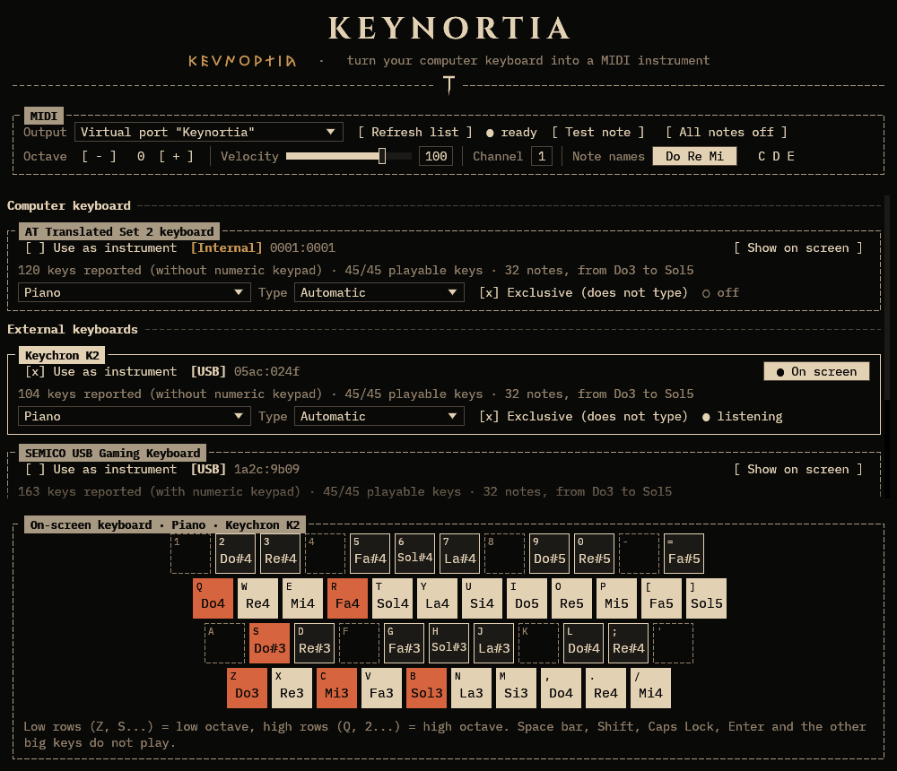
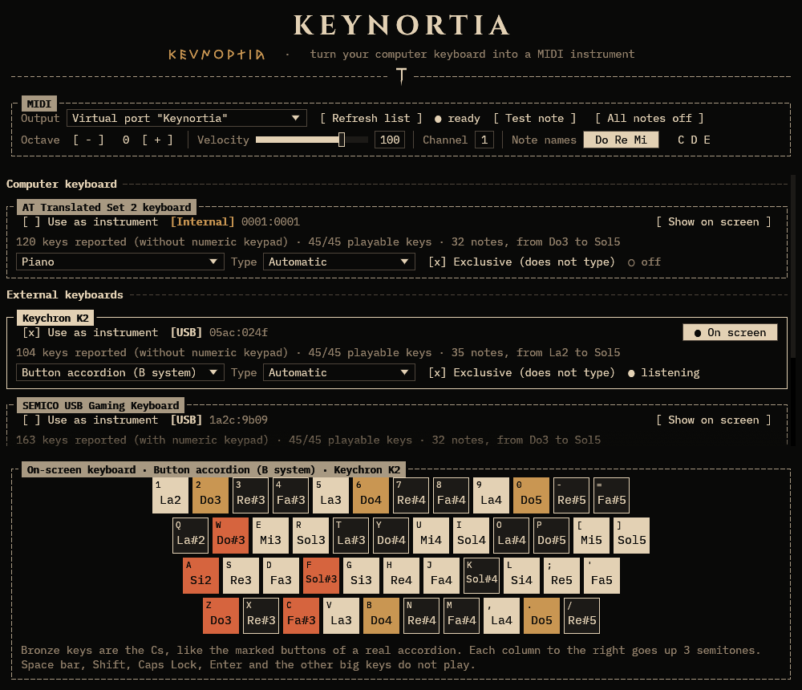

<p align="center">
  
</p>

<p align="center">
  <i>One keystroke at a time. One note at a time. Fate is in your hands.</i>
</p>

<p align="center">
  <b>Turn your computer keyboard into a MIDI instrument.</b><br>
  A piano or a button accordion on the small keys, with a different instrument for every keyboard.
</p>

<p align="center">
  <a href="https://github.com/anthonydifuria/keynortia/actions/workflows/ci.yml"></a>
  <a href="https://github.com/anthonydifuria/keynortia/releases/latest"></a>
  <a href="LICENSE"></a>
  
</p>

<p align="center">
  
  
</p>
<p align="center"><sub>The piano and the button accordion. The keyboards in the screenshots are made up.</sub></p>

---

## Contents

- [What is Keynortia](#what-is-keynortia)
- [Status](#status)
- [Install](#install) · [Linux](#linux) · [Windows](#windows) · [macOS](#macos)
- [Quick start](#quick-start)
- [Manual](#manual)
  - [The window](#the-window)
  - [The instruments](#the-instruments)
  - [Several keyboards at once](#several-keyboards-at-once)
  - [Exclusive mode](#exclusive-mode)
  - [Making sound](#making-sound)
  - [Keyboards held by other programs](#keyboards-held-by-other-programs)
  - [Troubleshooting](#troubleshooting)
  - [Limits of version 0.1](#limits-of-version-01)
- [Privacy and security](#privacy-and-security)
- [How it works](#how-it-works)
- [Building from source](#building-from-source)
- [Releasing](#releasing)
- [About the name](#about-the-name)
- [Credits and licenses](#credits-and-licenses)

## What is Keynortia

Keynortia reads your keyboards and sends **MIDI notes**. It makes no sound by itself: the notes go to any
synthesizer, sampler, plugdata patch or DAW you like, exactly as if you were playing a MIDI keyboard.

- **Two instruments, three layouts.** A piano, and a chromatic button accordion in the **B system** or in the
  **C system**. The layouts are fixed, on the 45 small keys of the four main rows (digits, QWERTY, ASDF, ZXCV).
- **One instrument per keyboard.** Play the piano on your laptop and the accordion on a USB keyboard, at the
  same time. Every keyboard is told apart from the others.
- **Exclusive mode.** While a keyboard is an instrument its keys only play: they no longer type in any other
  program.
- **Keys are identified by position**, not by the letter printed on them, so the layouts are the same on
  QWERTY, AZERTY, QWERTZ, Dvorak and so on.
- **Works in the background.** You can play while another program, a DAW for example, is in front.
- **Plug and play.** Keyboards appear and disappear by themselves. A Bluetooth keyboard that goes to sleep and
  wakes up starts playing again without a click.
- **MIDI out** through a virtual port called `Keynortia` (Linux and macOS), or through any MIDI port that already
  exists (on Windows: loopMIDI, the Microsoft GS Wavetable Synth...).
- An **on-screen keyboard** that lights up the keys you press, with the name of every note (Do Re Mi or C D E).
- Octave shift, velocity and MIDI channel.
- One small native program, written in Rust, with a terminal-inspired look in the Etruscan style.
  It never connects to the internet.

## Status

Keynortia is at version **0.1**.

- **Linux** is the main platform, and the one that has been tried on real keyboards.
- **Windows and macOS** are new in 0.1. They are built and tested automatically on every change, but they have
  seen little use on real machines, above all the exclusive mode (see [Exclusive mode](#exclusive-mode)).
  If something does not work, please [open an issue](https://github.com/anthonydifuria/keynortia/issues) and say
  which system, which keyboard and what the window says.

| | Linux | Windows | macOS |
| --- | --- | --- | --- |
| Tells the keyboards apart | yes | yes | yes |
| Exclusive mode | yes, always | yes, with a keyboard hook | best effort: macOS may refuse |
| Virtual MIDI port `Keynortia` | yes | no (use [loopMIDI](#windows)) | yes |
| One-time setup | join the `input` group | loopMIDI, to reach other programs | allow *Input Monitoring* |

## Install

Download the file for your system from the
[**Releases** page](https://github.com/anthonydifuria/keynortia/releases/latest). `SHA256SUMS` has the checksum of
each file.

| Your system | File |
| --- | --- |
| Ubuntu, Debian, Linux Mint, Pop!_OS... | `keynortia_<version>-1_amd64.deb` (`arm64` on ARM) |
| Fedora, RHEL, openSUSE... | `keynortia-<version>-1.x86_64.rpm` (`aarch64` on ARM) |
| Arch Linux, Manjaro, EndeavourOS... | `keynortia-<version>-1-x86_64.pkg.tar.zst` |
| Any other Linux | `keynortia-<version>-linux-x86_64.tar.gz` (`aarch64` on ARM) |
| Windows 10 and 11 | `keynortia-<version>-windows-x86_64.zip` |
| macOS 11 or later, Apple silicon and Intel | `Keynortia-<version>-macos.dmg` |

### Linux

The Linux files are built on Ubuntu 22.04, so they need glibc 2.35 or newer: Ubuntu 22.04 or later, Debian 12 or
later, Fedora 36 or later, current Arch. On an older system, [build from source](#building-from-source).

**Ubuntu, Debian and relatives**

```sh
sudo apt install ./keynortia_*_amd64.deb
```

**Fedora and relatives**

```sh
sudo dnf install ./keynortia-*.x86_64.rpm
```

**Arch and relatives**

```sh
sudo pacman -U keynortia-*-x86_64.pkg.tar.zst
```

or build the package yourself from the repository, which also works on ARM:

```sh
git clone https://github.com/anthonydifuria/keynortia.git
cd keynortia/packaging/arch
makepkg -si
```

**Any other Linux**

```sh
tar xf keynortia-*-linux-x86_64.tar.gz
cd keynortia-*-linux-x86_64
./keynortia
```

The program needs the ALSA library (`libasound2` or `alsa-lib`) and OpenGL, which every desktop has. To get an
entry in the application menu put `keynortia` in a folder of your `PATH` (`~/.local/bin`, say), copy
`keynortia.desktop` to `~/.local/share/applications/` and `keynortia.png` to
`~/.local/share/icons/hicolor/256x256/apps/`.

**One thing to do once: let your user read the keyboards.** Linux keeps the input devices for members of the
`input` group. Add yourself to it, then log out and back in (or reboot):

```sh
sudo usermod -aG input $USER
```

If you forget, Keynortia tells you, with this very command, when you start it.

### Windows

1. Extract the zip anywhere and double-click `keynortia.exe`.
2. Windows may say *"Windows protected your PC"*, because the program is not code-signed. Click **More info**,
   then **Run anyway**.
3. To hear something right away you do not need anything else: Keynortia sends the notes to the *Microsoft GS
   Wavetable Synth* that comes with Windows.
4. To play through **plugdata, a DAW or any other program**, Windows needs a virtual MIDI cable. Install the free
   [loopMIDI](https://www.tobias-erichsen.de/software/loopmidi.html) and create a port in it, named `Keynortia`
   for example. Keynortia picks it by itself, and you enable the same port among the MIDI inputs of the other
   program. See [Making sound](#making-sound).

### macOS

1. Open the `.dmg` and drag **Keynortia** onto **Applications**.
2. The first time, macOS blocks apps that are not notarized. Open Keynortia once and close the warning, then
   open **System Settings → Privacy & Security**, scroll down and click **Open Anyway**. (On macOS 14 and older
   Control-click → **Open** does the same.) Or, in Terminal:
   ```sh
   xattr -dr com.apple.quarantine /Applications/Keynortia.app
   ```
3. macOS only lets a program read the keyboards if you allow it. When you tick **Use as instrument** for the first
   time, macOS asks for **Input Monitoring**: allow it in **System Settings → Privacy & Security → Input
   Monitoring**, then quit and reopen Keynortia.

The app is signed ad hoc, without a developer account. After an update macOS may forget the permission: remove
Keynortia from the Input Monitoring list with **−** and add it again.

## Quick start

1. **Start Keynortia.** The window has three parts: the MIDI settings at the top, the list of your keyboards, and
   the on-screen keyboard at the bottom.
2. **Make sure something is listening.** Press **Test note**: you should hear a middle C. If you do not, read
   [Making sound](#making-sound).
3. **Tick *Use as instrument*** on the keyboard you want to play. An external keyboard is the comfortable choice:
   the keys of this keyboard stop typing as long as the box is ticked.
4. **Pick the instrument** in the list below the name: Piano, Button accordion (B system) or (C system).
5. **Play** on the digits, QWERTY, ASDF and ZXCV rows. The on-screen keyboard shows the note of every key.
6. To stop, **untick *Use as instrument*** with the mouse. Closing the window frees the keyboards too.

> **If your only keyboard is the one you are playing,** keep the mouse at hand: with *Exclusive* on, the keys of
> that keyboard cannot type anything else. Untick *Use as instrument*, or close the window, and it types again.

## Manual

### The window

**MIDI** (top)

| Control | What it does |
| --- | --- |
| **Output** | Where the notes go: the virtual port `Keynortia` (Linux, macOS) or one of the MIDI ports that already exist. **Refresh list** looks for new ports. |
| **● ready** | The output is open. A red message appears instead if it could not be opened. |
| **Test note** | Plays a middle C for half a second, without using any keyboard. Handy to check the connection. |
| **All notes off** | Silences everything, on all 16 channels. Use it if a note ever gets stuck. |
| **Octave − / +** | Shifts every keyboard by whole octaves, from −3 to +3. |
| **Velocity** | Loudness of every note, 1 to 127 (100 at the start). |
| **Channel** | MIDI channel, 1 to 16. |
| **Note names** | *Do Re Mi* or *C D E*. Only changes how Keynortia writes the notes, not the MIDI. Middle C is Do4 / C4. |

**Keyboards** (middle). Computer keyboards (the laptop's own) and external keyboards (USB, Bluetooth) are listed in
two groups, one framed box for each keyboard:

| Part of the box | What it means |
| --- | --- |
| Title and `[USB]` / `[Bluetooth]` / `[Internal]` | The name the system gives the keyboard and how it is connected. Hover over the badge to see how the system describes it. |
| `1a2c:9b09` | Vendor and product identifier: the same ones `lsusb` or the Device Manager show. |
| **Use as instrument** | Starts and stops reading this keyboard. Off at the start for every keyboard. |
| **Show on screen** / **● On screen** | Which keyboard the on-screen keyboard follows. Ticking a keyboard selects it. |
| `120 keys reported (...) · 45/45 playable keys · 32 notes, from Do3 to Sol5` | What the keyboard says it has, how many of the 45 small keys it has, and the range of notes it can play with the chosen instrument. |
| Instrument list | Piano, Button accordion (B system) or (C system), for this keyboard only. |
| **Type** | *Automatic*, *Computer keyboard* or *External keyboard*: in which group the keyboard is shown. Keynortia decides by how it is connected; correct it here if it guesses wrong. |
| **Exclusive (does not type)** | See [Exclusive mode](#exclusive-mode). On at the start. |
| **● listening** / **○ off** | The state. A message in red says why a keyboard could not be opened; a message in bronze is a warning. |

**Virtual devices** (collapsed) holds the keyboards that other programs create, such as key remappers. See
[Keyboards held by other programs](#keyboards-held-by-other-programs).

**No sound?** (collapsed, below the list) is a short guide for the system you are on.

**On-screen keyboard** (bottom). The keys of the instrument with the note of each one. A key lights up while you
press it. On the accordion the C keys are bronze, like the marked buttons of a real accordion.

The program does not save anything between runs: it starts with the piano, octave 0, velocity 100, channel 1.
While it is open, it remembers the choices for each keyboard, so a keyboard that is unplugged and plugged back in
starts again by itself.

### The instruments

Only the **45 small keys** of the four main rows play. The space bar, Shift, Caps Lock, Enter, Tab, Backspace,
Ctrl, Alt, the arrows, the function keys and the numeric keypad make no sound. (With *Exclusive* on, they do not
type either: see [Exclusive mode](#exclusive-mode).)

The keys are found by position. The letters below are those of a US keyboard; on any other keyboard use the keys
in the same places. **Z** is always the first key at the bottom left of the letter block. The notes below are for
octave 0: middle C is **C4** (MIDI 60). Press **Octave +** or **−** to move up or down.

#### Piano

Two rows of keys make one octave, like on a real piano: the bottom row plays the white keys and the row above
it the black ones, and the black keys sit between the white keys exactly as they do on the piano. There are two
octaves: the **low** one on `Z` and `A`, the **high** one on `Q` and the digits.

```
    1   2   3   4   5   6   7   8   9   0   -   =
    ·   C#4 D#4 ·   F#4 G#4 A#4 ·   C#5 D#5 ·   F#5

      Q   W   E   R   T   Y   U   I   O   P   [   ]
      C4  D4  E4  F4  G4  A4  B4  C5  D5  E5  F5  G5

       A   S   D   F   G   H   J   K   L   ;   '
       ·   C#3 D#3 ·   F#3 G#3 A#3 ·   C#4 D#4 ·

         Z   X   C   V   B   N   M   ,   .   /
         C3  D3  E3  F3  G3  A3  B3  C4  D4  E4
```

`·` marks a key that is silent because a piano has no black key there. The range is **C3 to G5**: 32 notes on
37 keys. The notes from C4 to E4 can be played from the low rows (`,` `.` `/` and `L` `;`) and from the high rows
(`Q` `W` `E` and `2` `3`): handy to run from one octave into the next.

#### Button accordion

A chromatic button accordion has the same pattern of notes everywhere, so a chord or a scale has the same shape
wherever you play it. In both systems:

- going **one key to the right** along a row raises the pitch by **3 semitones** (a minor third);
- going **one row down** (to the key below, which is shifted to the right) raises it by **1 semitone** in the
  B system and by **2 semitones** in the C system. The C system is the mirror image of the B system.

All 45 keys play, over 35 different notes. The accordion layouts are on the whole keyboard, not split in two
octaves, so `Q`, `A` and `Z` are the first column and the digits are a fourth row above `Q`.

**B system.** The C is in the third row: `Q A Z` are A#2 B2 C3. Range A2 to G5.

```
    1   2   3   4   5   6   7   8   9   0   -   =
    A2  C3  D#3 F#3 A3  C4  D#4 F#4 A4  C5  D#5 F#5

      Q   W   E   R   T   Y   U   I   O   P   [   ]
      A#2 C#3 E3  G3  A#3 C#4 E4  G4  A#4 C#5 E5  G5

       A   S   D   F   G   H   J   K   L   ;   '
       B2  D3  F3  G#3 B3  D4  F4  G#4 B4  D5  F5

         Z   X   C   V   B   N   M   ,   .   /
         C3  D#3 F#3 A3  C4  D#4 F#4 A4  C5  D#5
```

**C system.** The C is in the first row: `Q A Z` are C3 D3 E3. Range A#2 to A5.

```
    1   2   3   4   5   6   7   8   9   0   -   =
    A#2 C#3 E3  G3  A#3 C#4 E4  G4  A#4 C#5 E5  G5

      Q   W   E   R   T   Y   U   I   O   P   [   ]
      C3  D#3 F#3 A3  C4  D#4 F#4 A4  C5  D#5 F#5 A5

       A   S   D   F   G   H   J   K   L   ;   '
       D3  F3  G#3 B3  D4  F4  G#4 B4  D5  F5  G#5

         Z   X   C   V   B   N   M   ,   .   /
         E3  G3  A#3 C#4 E4  G4  A#4 C#5 E5  G5
```

A keyboard that lacks some of the 45 keys (a compact one without the digits row, say) just plays fewer notes: the
box says how many.

### Several keyboards at once

Every keyboard has its own instrument and is read on its own, so the laptop can play the piano while a USB keyboard
plays the accordion. They share the output, the octave, the velocity and the channel. If two keys, on one keyboard
or on two, play the same note, the note stops only when both are released.

The list updates by itself every second or so: plug in a keyboard and it shows up.

### Exclusive mode

With **Exclusive (does not type)** on, which is the default, the keys of the keyboard play and do nothing else:
they do not type in the program you are using. With it off, the keyboard plays *and* types.

| System | How it works |
| --- | --- |
| **Linux** | The kernel gives the keyboard to Keynortia alone (`EVIOCGRAB`). It works for every program, on X11 and on Wayland, and it ends by itself if Keynortia closes or crashes. |
| **Windows** | Windows cannot take one keyboard away from the rest, so a keyboard hook swallows the key when Windows says it came from an exclusive keyboard. If Windows does not say in time, the key goes through: typing is never lost. Programs that run **as administrator** are out of reach for the hook, so in their windows an exclusive keyboard also types. |
| **macOS** | Keynortia asks macOS to *seize* the keyboard. macOS may refuse, the keyboard of the laptop above all: then the keyboard plays and types, and the window says so next to *listening*. An external keyboard is the best bet. |

If exclusive mode does not work for you, the simplest answer is to play with the window of Keynortia in front,
or in a text field where the extra letters do no harm.

### Making sound

Keynortia sends MIDI; a **synthesizer** makes the sound. The first step is always the same: pick the **Output** in
the MIDI box, then check with **Test note**.

#### Linux

Keynortia opens a virtual port called **Keynortia** (an ALSA sequencer port; with PipeWire it shows up in the
patchbay too). Two ways to use it:

1. **Pick the synthesizer's port in the *Output* list** (press **Refresh list** after starting the synthesizer).
2. **Keep the virtual port** and connect it to the synthesizer, with your DAW, with `qpwgraph`, or with
   `aconnect`: `aconnect -l` shows the clients, then `aconnect <Keynortia client>:0 <synthesizer client>:0`.

A quick synthesizer to try is FluidSynth, with a General MIDI soundfont (`fluid-soundfont-gm` on Debian, Ubuntu and
Fedora, `soundfont-fluid` on Arch):

```sh
fluidsynth -a pulseaudio -m alsa_seq /path/to/soundfont.sf2
```

Use `-a pipewire`, `-a alsa` or `-a jack` if that suits your system better.

#### Windows

- **Quickest test:** leave the *Output* on **Microsoft GS Wavetable Synth**. It is chosen at the start when there
  is no loopMIDI port.
- **To reach another program:** install [loopMIDI](https://www.tobias-erichsen.de/software/loopmidi.html), start
  it, create a port, press **Refresh list** in Keynortia and pick that port as the *Output*. Then, in the other
  program, enable the **same** port among the MIDI inputs.

#### macOS

Keynortia opens a virtual port called **Keynortia**. Start Keynortia first, then in the program that makes the
sound (GarageBand, Logic Pro, plugdata, a standalone synth...) enable **Keynortia** among the MIDI inputs. Or pick
the synthesizer's own port in the *Output* list.

#### plugdata

1. Start Keynortia first, so that its port exists (Linux, macOS). On Windows create the loopMIDI port first.
2. In plugdata's settings, enable the port (`Keynortia`, or the loopMIDI port) among the **MIDI input devices**.
3. Put a `[notein]` object in the patch. It outputs the note, the velocity and the channel.

### Keyboards held by other programs

Some programs take the keyboards for themselves so that they can remap keys, and they put them back together as one
*virtual* keyboard. While one holds a keyboard, Keynortia cannot read it by itself:

- **keyd** (Linux). When Keynortia finds a keyboard that keyd holds, it offers **Free it from keyd…**. It shows what it
  is going to change (a `-vendor:product` line under `[ids]` in the keyd configuration, with a backup copy), asks for
  your administrator password, and restarts keyd. Your other keyboards stay as they are. **Copy command** gives
  you the same change as a command for a terminal, if you prefer.
- **kmonad, Karabiner-Elements and other remappers.** Exclude the keyboard you want to play from that program, in
  its own settings. Keynortia says "already taken by another program" while it is held.
- The virtual keyboards that these programs create are in **Virtual devices**. Playing through one of them plays
  *everything* that the remapper puts together, the laptop keyboard included, so it is better to exclude the
  external keyboard from the program and play that one.

### Troubleshooting

**On every system**

| Problem | What to do |
| --- | --- |
| No sound | Press **Test note**. If you hear nothing, the problem is between Keynortia and the synthesizer: see [Making sound](#making-sound), and check the volume and that the synthesizer listens to the right port and channel. If the test works but the keys do not, read on. |
| The keys do nothing | The box of the keyboard must say **● listening**. Tick **Use as instrument**. Only the 45 small keys play: check on the on-screen keyboard. Make sure that you are playing on the keyboard you ticked. |
| A note will not stop | Press **All notes off**. |
| The keyboard no longer types | That is *Exclusive* at work. Untick **Use as instrument** with the mouse, or close the window. |
| The notes are not where I expect | The keys are found by position, not by the letter printed on them. Compare with the on-screen keyboard; **Octave** and **Note names** also change what you see. |
| Some keys do not play when I press many at once | Cheap keyboards cannot report more than a few keys at a time, and some combinations are lost ("ghosting"). Gaming keyboards with *N-key rollover*, over USB, are the best. |

**Linux**

| Problem | What to do |
| --- | --- |
| *Cannot read the system keyboards* | Run `sudo usermod -aG input $USER`, then log out and back in. |
| *permission denied: add your user to the input group* | The same. |
| *already taken by another program (keyd, kmonad...)* | See [Keyboards held by other programs](#keyboards-held-by-other-programs). |
| The synthesizer does not see the port | Start Keynortia before the synthesizer, or press **Refresh list** in the synthesizer. `aconnect -l` lists what exists. |
| The window does not open on an old or virtual machine | Keynortia needs OpenGL. Try `LIBGL_ALWAYS_SOFTWARE=1 keynortia`. |

**Windows**

| Problem | What to do |
| --- | --- |
| *Windows protected your PC* | The program is not code-signed. **More info → Run anyway**. |
| An antivirus complains | Keynortia reads the keyboard in the background, which is also what keyloggers do, so some antivirus programs are wary. The source is here and the program never uses the network; if in doubt, [build it yourself](#building-from-source). |
| *this system cannot create virtual MIDI ports* | Windows has none: pick an existing port, or install [loopMIDI](https://www.tobias-erichsen.de/software/loopmidi.html). |
| The loopMIDI port is not in the list | Start loopMIDI, create a port, press **Refresh list**. |
| *exclusive mode does not work on this system: this keyboard also types* | Windows never told Keynortia which keyboard the keys came from, which can happen in a remote desktop session, in some virtual machines or with software that filters the keyboard. Keynortia lets the keys through rather than lose your typing. Untick **Exclusive** and play with Keynortia in front. |
| *could not install the keyboard hook* | Windows refused the hook. Untick **Exclusive**, or close the programs that also watch the keyboard, and tick **Use as instrument** again. |
| An exclusive keyboard still types in one program | That program runs as administrator, and Windows keeps the hook out of it. |

**macOS**

| Problem | What to do |
| --- | --- |
| *macOS has not allowed Keynortia to read the keyboards* | **System Settings → Privacy & Security → Input Monitoring**: switch Keynortia on (if you started it from a terminal, switch that terminal on), then quit and reopen it. |
| It worked before an update and now it does not | Remove Keynortia from the Input Monitoring list with **−**, add it again, and reopen it. |
| *macOS did not allow exclusive mode for this keyboard: it also types* | macOS refused to seize that keyboard, which often happens with the one built into the laptop. Use an external keyboard, or untick **Exclusive**. |
| *already taken by another program (a key remapper such as Karabiner-Elements...)* | Exclude that keyboard in the remapper. |
| The app "cannot be opened" or "is damaged" | See [macOS](#macos): **Open Anyway**, or the `xattr` command. |
| The synthesizer does not list Keynortia | Start Keynortia first, then look again, or restart the synthesizer. |

### Limits of version 0.1

- Only the 45 small keys play, and the three layouts are fixed: no custom mapping yet.
- The velocity is the same for every note: keyboards cannot tell how hard a key was pressed.
- Notes only. No sustain, pitch bend or modulation, and the big keys do nothing.
- One MIDI output at a time, shared by all the keyboards.
- Nothing is saved between runs.
- Windows and macOS are the new ports: the exclusive mode in particular has not seen much real use there.
- Keynortia sends each note as soon as it sees the key. The delay you hear comes mostly from the keyboard (wired
  ones are faster than Bluetooth ones), the synthesizer and the audio system.

## Privacy and security

- Keynortia has **no networking code**: it never connects to the internet, and sends nothing anywhere.
- It looks at the keys **only to turn them into notes**. It keeps no log and writes nothing to disk, apart from
  the keyd configuration if you ask it to free a keyboard.
- It acts only on the keyboards you switched on, and only on their 45 small keys. The rest of what you type is
  not looked at.
  - *Linux:* to list the keyboards it opens each input device once, to read its name and which keys it has. It
    reads key presses only from the keyboards you switched on. Being in the `input` group lets any program that
    runs as you read the keyboards: that is what the group is for, and it is the price of telling keyboards apart.
  - *Windows:* the system hands the key presses of all keyboards to the program, and Keynortia uses them only to know
    which keyboard a key came from. It keeps nothing, and acts on the keyboards you switched on.
  - *macOS:* the keyboards are listed without being opened, and read only when you switch them on. That is why
    macOS asks for the *Input Monitoring* permission.
- The releases are built by [GitHub Actions](.github/workflows/release.yml) from the tagged source, and `SHA256SUMS`
  lets you check the files you downloaded.

## How it works

Every operating system has its own way of telling keyboards apart, so Keynortia has one small **backend** for
each, behind the same interface:

| System | Lists the keyboards | Reads the keys | Exclusive mode |
| --- | --- | --- | --- |
| Linux | `/dev/input/event*` (evdev): name, bus, keys | one thread per keyboard | `EVIOCGRAB` |
| Windows | Raw Input device list and HID descriptors | `WM_INPUT` in a hidden window | low-level keyboard hook, matched with Raw Input |
| macOS | `IOHIDManager` | `IOHIDDevice` value callbacks | `IOHIDDeviceOpen` with the seize option |

Whatever the system, a key is identified by its **position**, using the Linux numbers (`KEY_Q` = 16...): each
backend translates its own codes into those. That is why the layouts do not depend on the language of the keyboard.

The **engine** turns the key events into MIDI messages, counting how many keys hold each note, and the **MIDI**
module sends them through the virtual port (Linux and macOS) or through an existing port, using
[midir](https://github.com/Boddlnagg/midir). The window is made with [egui](https://github.com/emilk/egui).

```
src/
  main.rs            the window and its icon
  app.rs             the interface
  layout.rs          the 45 keys and the three layouts
  engine.rs          key events to MIDI notes
  midi.rs            output ports
  keyboard_view.rs   the on-screen keyboard
  theme.rs           the look: colours, fonts, frames
  keyd.rs            freeing keyboards from keyd (Linux)
  devices.rs         what every backend offers
  devices/           linux.rs, windows.rs, macos.rs, and the logic that needs no system: hid_usage.rs, correlate.rs, winpath.rs
packaging/           desktop entry, PKGBUILD (Arch), Info.plist and bundle script (macOS)
.github/             CI and release workflows
```

## Building from source

You need **Rust 1.95 or newer** (install it with [rustup](https://rustup.rs)).

**Linux** also needs a C compiler, `pkg-config` and the ALSA headers:

```sh
# Debian, Ubuntu
sudo apt install build-essential pkg-config libasound2-dev
# Fedora
sudo dnf install gcc pkgconf-pkg-config alsa-lib-devel
# Arch
sudo pacman -S base-devel rust alsa-lib
```

**Windows** needs the MSVC build tools (*Desktop development with C++* in the Visual Studio Build Tools).
**macOS** needs the Xcode command line tools (`xcode-select --install`).

Then:

```sh
git clone https://github.com/anthonydifuria/keynortia.git
cd keynortia
cargo run --release
```

`cargo test` runs the unit tests, which need no keyboard and no sound card. The CI runs `cargo fmt --check`,
`cargo clippy -- -D warnings` and `cargo test` on Linux (x86_64 and arm64), Windows and macOS.

To make the packages yourself, after `cargo build --release`: `cargo install cargo-deb cargo-generate-rpm`, then
`cargo deb --no-build` and `cargo generate-rpm` (Linux), or `bash packaging/macos/bundle.sh <binary> <version> <folder>`
(macOS).

## Releasing

For the maintainer. A release is made by pushing a tag:

1. Set the new `version` in `Cargo.toml` (and `pkgver` in `packaging/arch/PKGBUILD`, which the release workflow
   replaces anyway but the AUR needs right), and commit.
2. Tag it and push the tag. The tag must be `v` plus the version:
   ```sh
   git tag v0.1.0
   git push origin main --tags
   ```
3. The **Release** workflow builds on GitHub's machines: `.deb` and `.rpm` and a tarball for Linux x86_64 and arm64,
   an Arch package (inside an Arch container), a Windows zip, and a universal macOS `.dmg`. When every build has
   passed it creates the release with the files, `SHA256SUMS` and the notes from `.github/release-notes.md`
   followed by the automatic list of changes. A version with a dash, such as `0.2.0-rc1`, is marked as a
   pre-release.

To try the whole thing without publishing, open **Actions → Release → Run workflow**: it builds everything and
leaves the files in the run, as downloadable artifacts. If the workflow is run again for a tag that already has a
release, the files are replaced.

To publish on the **AUR**: copy `packaging/arch/PKGBUILD` to a clone of `ssh://aur@aur.archlinux.org/keynortia.git`,
run `updpkgsums` and `makepkg --printsrcinfo > .SRCINFO`, check that `makepkg -si` works, then commit and push.

## About the name

Keynortia is inspired by **Nortia**, an Etruscan goddess of fate and fortune: it turns every keystroke into a note,
weaving your own musical destiny.

Roman writers tell that nails were fixed in the wall of her temple at Volsinii, one for each year. The nails and the
hammer of the logo recall them, and the title of the window is written in Etruscan letters (the Old Italic alphabet)
as well as in plain ones.

> One keystroke at a time. One note at a time. Fate is in your hands.

## Credits and licenses

Keynortia is released under the [MIT License](LICENSE).

The program contains these fonts, under the [SIL Open Font License 1.1](https://openfontlicense.org); the text of the
license of each one is in [`assets/fonts`](assets/fonts) and comes with every download:

- **IBM Plex Mono**, for the text of the interface
- **Cinzel**, for the title
- **Noto Sans Old Italic**, for the Etruscan letters

It is built on [egui and eframe](https://github.com/emilk/egui), [midir](https://github.com/Boddlnagg/midir),
[evdev](https://github.com/emberian/evdev), [windows-sys](https://github.com/microsoft/windows-rs) and
[core-foundation](https://github.com/servo/core-foundation-rs): thanks to everyone who works on them.
